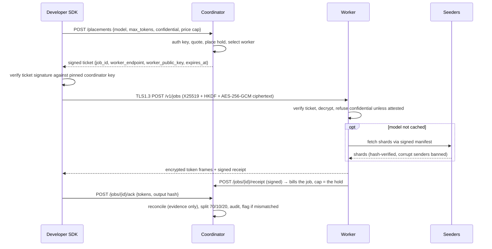

# TCDN-AI — architecture

## 1. Components

```
┌────────────┐  1 placement (no prompt)   ┌──────────────────────────────┐
│ Developer  │ ─────────────────────────▶ │ Coordinator (FastAPI)        │
│ SDK        │ ◀── signed ticket ──────── │ auth · registry · scheduler  │
│ (Python)   │                            │ holds · receipts · ledger    │
└─────┬──────┘                            │ manifests · attestation      │
      │ 2 TLS 1.3 + X25519/AES-256-GCM    └───────┬──────────────┬───────┘
      │   (prompt never leaves this path)         │              │
      ▼                                           │ 5 receipts   │ 6 audit
┌────────────────┐  3 shards (verified)   ┌───────▼──────┐  ┌────▼────────┐
│ Worker agent   │ ◀───────────────────── │ Seeder swarm │  │ PostgreSQL  │
│ vLLM / Ollama  │   signed manifest      │ (P2P peers)  │  │ ai_* tables │
└────────────────┘                        └──────────────┘  └─────────────┘
```

| Component | Code | Responsibility |
|---|---|---|
| Coordinator | `backend/app/ai/{routes,service,store,ledger,pricing,tickets,scheduler,receipts,verification}.py` | Placement, holds, settlement, registry, audit |
| Crypto | `backend/app/ai/{crypto,keyring}.py` | Domain-separated signatures, AEAD, key rotation/revocation |
| Worker | `backend/app/ai/worker.py` | Ticket validation, decryption, engine adapter, encrypted streaming, signed receipt |
| P2P weights | `backend/app/ai/shards.py` | Signed manifest, Merkle, swarm fetch, corrupt-peer banning, sinks |
| Confidential | `backend/app/ai/attestation.py` | Verifier interface, policy, simulated + fail-closed real adapters |
| Billing | `backend/app/ai/{payments,payouts,burn}.py` | Credit purchases, seeder distribution, disabled burn |
| SDK | `backend/tcdn_ai_sdk/` | OpenAI-compatible client, ticket verification, per-request encryption |
| Gateway | `backend/app/ai/{gateway,routes_openai}.py` | OpenAI-compatible `/v1` surface (gateway mode): coordinator relays plaintext to the worker over the same encrypted session; standard tier only, never logged |

## 2. Job lifecycle (implemented)



**Billing authority in gateway mode.** The gateway holds the plaintext of the
request and the completion, so it measures both itself: the prompt it encrypted
and the token frames it decrypted and delivered (`GatewayMeasurement`). Where
that measurement and the receipt disagree beyond tolerance, the **lower** count
is billed and the node's counters are updated; the receipt stays authority only
where no measurement exists (SDK mode, or a job no gateway handled). Both are
recorded as evidence for review, never as a verdict. A node whose receipts bill
above the gateway's count in more than `node_overclaim_rate_pct` of its settled
jobs (once it has `node_overclaim_min_samples` of them) is suspended and its
pending payouts are held for an operator.

**Ordering that matters:** the hold is placed before the job row exists; the
receipt is verified against the node that was assigned the job; and the receipt
— not the client's ack — is what settles. Billing on the ack made revenue
optional for the payer: a client that never acked left the job unsettled, and
the expiry sweep then released the hold, so the completion was free. Settlement
now bills the receipt's own token counts capped at the placed hold, and the ack
is evidence: a hash or count mismatch flags the job for review while the charge
stands (the admin refund path is the only way money moves back). Settlement also
runs once per job whichever order the receipt and the measurement arrive in, and
neither can re-price a job that has already settled.

## 3. Trust boundaries and tiers

| Tier | `confidentiality` | Protection |
|---|---|---|
| Standard | `none` | TLS + application-layer encryption to the worker, but the host operator can read plaintext. Labelled everywhere. |
| Confidential | `attested-tee` | Placement requires a live, verified attestation bound to the worker's session key; worker refuses the job if it is not itself attested. No downgrade path. |

The coordinator is trusted for metadata, ticket issuance and settlement, but it
never receives prompt content and cannot read worker traffic: it has no session
private key.

## 4. Data model

`ai_accounts`, `ai_api_keys`, `ai_nodes`, `ai_jobs`, `ai_holds`,
`ai_ledger_entries`, `ai_receipts`, `ai_attestations`, `ai_models`,
`ai_model_prices`, `ai_transfer_receipts`, `ai_payouts`, `ai_signup_grants`,
`ai_audit_log`. DDL lives in `backend/app/ai/store.py::AI_TABLES_DDL` and is
applied idempotently at startup, matching the repo's existing migration style.

Money is integer micro-credits everywhere (1 credit = 1e6 micro; $1 = 1e8 micro).
`ai_ledger_entries.idempotency_key` is unique, so a replay cannot double post.

## 5. Concurrency and failure behaviour

| Situation | Behaviour |
|---|---|
| Concurrent placements on one balance | Postgres advisory lock per account + `available = balance − open holds`; second hold fails with 402 |
| Duplicate settlement | `idempotency_key` unique + `job.status` guard; replay returns the original result |
| Worker disappears before output | SDK re-places (no output consumed) |
| Worker fails after first token | SDK raises `PartialResultError` with the partial text; billing uses verified tokens |
| Coordinator restart | All state is in Postgres; in-process replay caches/nonces reset (documented limitation) |
| Corrupt shard | Rejected before the sink, sender banned for the fetch, retry on another peer, origin fallback hook |
| Attestation missing/expired | Placement fails with `no_attested_worker`; worker independently refuses |

## 6. Why these choices

- **FastAPI + asyncpg + in-repo DDL** — matches the existing backend; no second
  persistence stack.
- **SDK in Python** — the repo's only backend language. A TypeScript port is
  specified, not half-built (`SDK-PORT-SPEC.md`).
- **`ShardPeer` seam for weights** — the browser P2P layer is WebTorrent/WebRTC and
  cannot be driven from a Python worker without a JS runtime. Manifest/Merkle/
  integrity logic is transport-agnostic and fully tested; the transport adapter is
  the documented gap.
- **Receipt + sampling over "trust the worker"** — receipts prove which code ran and
  what it claimed; sampling provides probabilistic correctness assurance.
